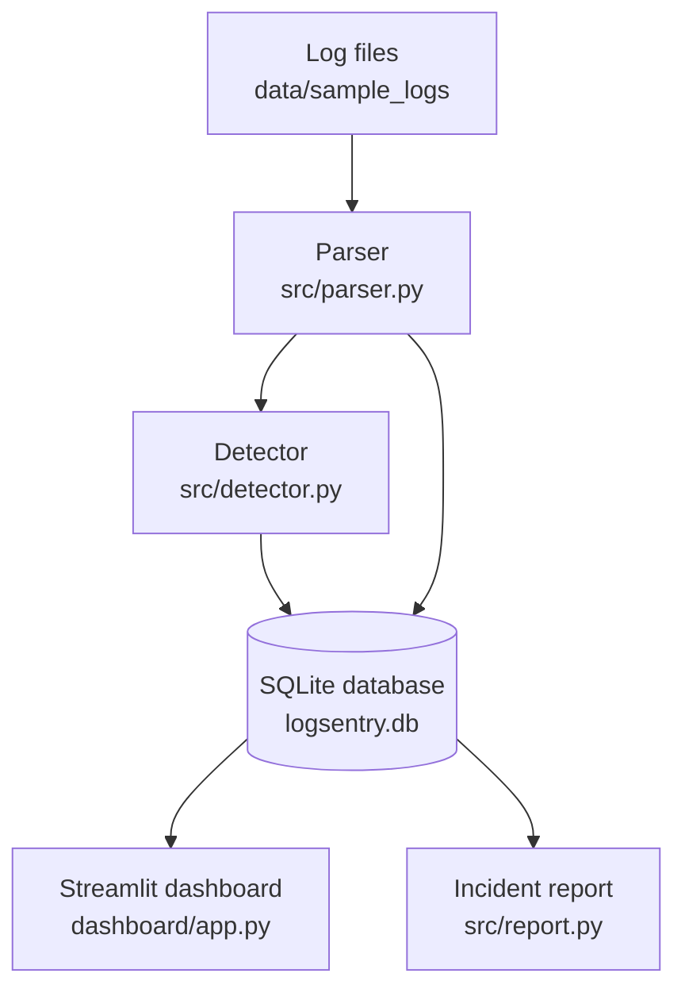

# LogSentry Architecture

- **Parser:** turns each valid line into a structured event and skips bad lines.
- **Detector:** finds many failed logins from one IP in a short time.
- **Database:** stores events and alerts, and blocks duplicates.
- **Dashboard:** shows alerts, evidence and filters, with a report download.
- **Report:** writes a plain-English incident report.
